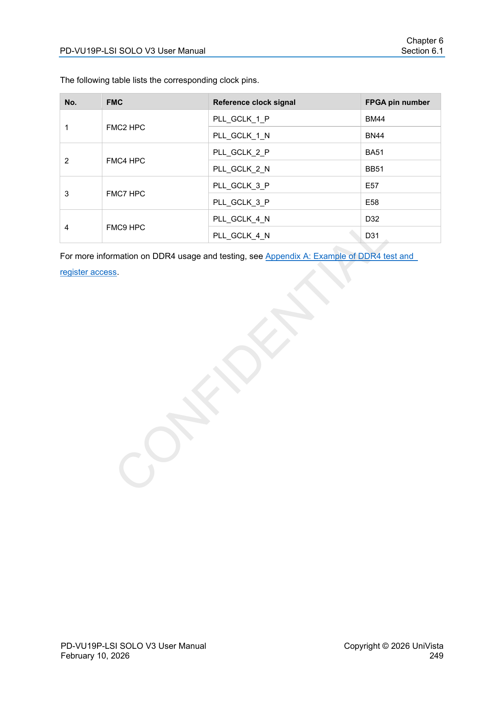
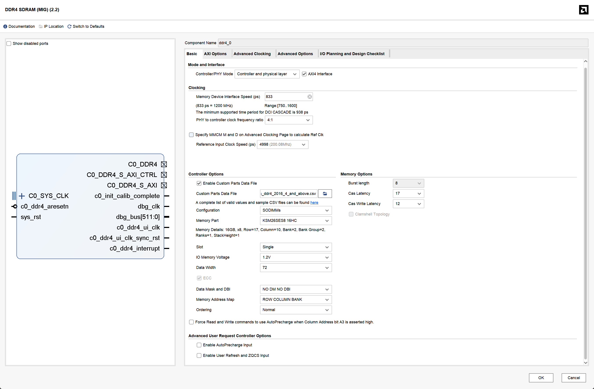
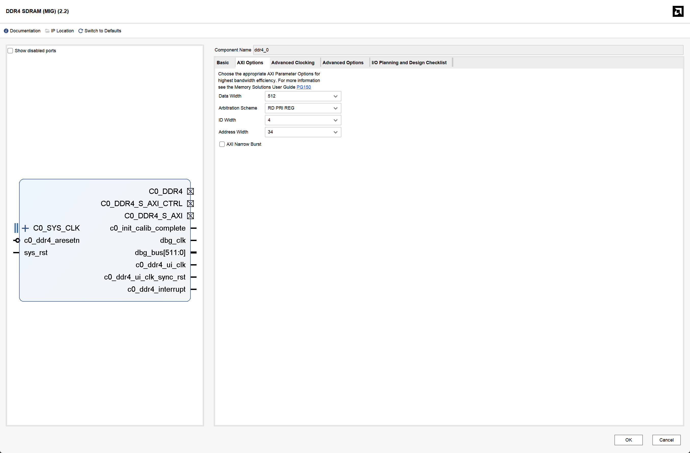
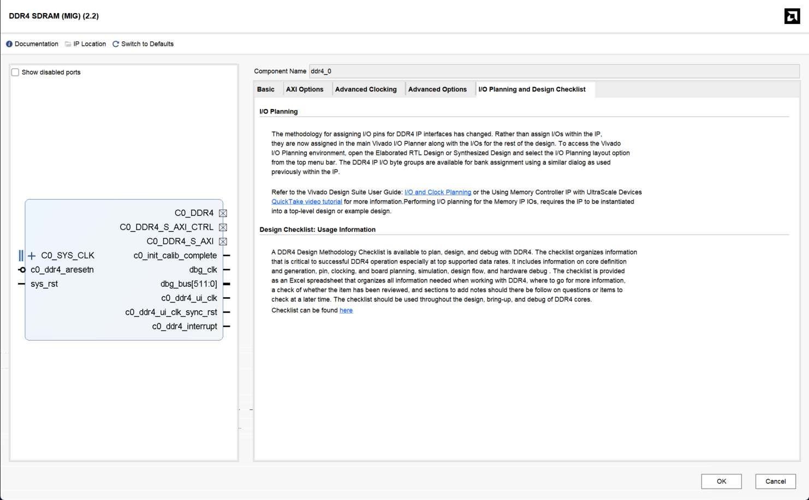
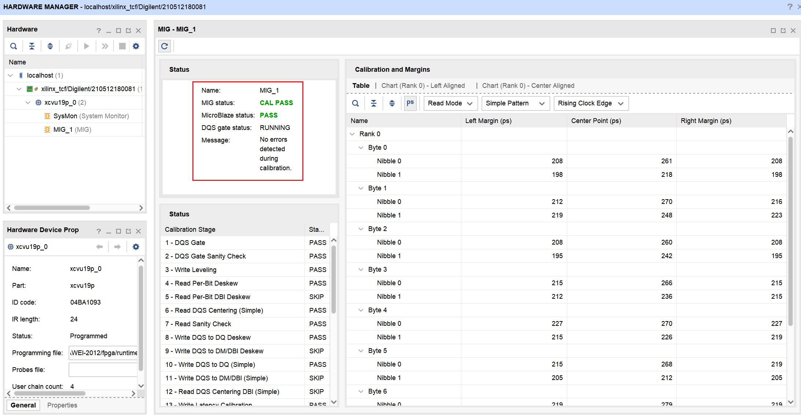

# 4.1.2 使用 VU19P-SOLO V3 上的 DRAM

本文记录 **UniVista PD-VU19P-LSI SOLO V3** 的 DDR4 子卡接入流程：

```text
安装并连接 AEConsole
  → 配置 FMC9 电压与参考时钟
  → 用 Vivado GUI 生成 DDR4 MIG
  → 把 MIG 接到自己 SoC 的 AXI
  → 补顶层 XDC
  → 综合、实现、生成 bitstream
  → 上板检查 CAL PASS 与 SoC 读写
```

本文以本机 Windows 11 + Vivado 2023.2 + AEConsole 2.4.2 为例。板卡 IP、安装目录、PC 网卡名等属于本机配置，换机器时按实际值替换。

文中给出的 AXI 位宽转换、CDC 和 xbar 都是 **PULP common cells** 中的通用模块（Solderpad 0.51），不依赖某个具体项目的 RTL；SoC 侧的端口名、地址窗口和文件组织请按自己的工程调整。

## 1. 硬件组合与关键参数

本例使用：

| 部件 | 型号 | 关键参数 |
|---|---|---|
| FPGA 平台 | PD-VU19P-LSI SOLO V3 | DUT-FPGA 为 `xcvu19p-fsva3824-2-e` |
| DDR 子卡 | **UV-FMCH-PDDR4DME** | 260-pin DDR4 DIMM 插槽，最高 2400 Mbps |
| 内存条 | **Kingston KSM26SES8/16HC** | 16 GiB、1Rx8、DDR4-2666、ECC SODIMM、1.2 V |
| 颗粒 | **SK hynix H5ANAG8NCJR** | 16Gb x8，Row 17 / Column 10，DDR4-3200 速率档 |

速率按最低者决定：

```text
min(子卡 2400, 内存条 2666, 颗粒 3200) = 2400 Mbps
```

因此 MIG 的 **Memory Device Interface Speed = 833 ps**。不要因为内存条标称 2666 就配置为 750 ps。

时钟分三类：

| 时钟 | 当前值 | 来源与用途 |
|---|---:|---|
| SoC 系统时钟 | 20 MHz | 由 SoC 的 `clock_ip` 生成，供 CPU 和 SoC AXI 使用 |
| MIG 参考时钟 | 200 MHz | 板级 Si5345 的 **GC08 / HP71_GC08**，FPGA 引脚 **D32/D31** |
| MIG `ui_clk` | 300 MHz | **MIG 内部 PLL** 产生，供 MIG AXI 使用 |

MIG 的 PHY 时钟和 `ui_clk` 都由 MIG 内部管理，**不需要再为 MIG PHY 单独例化 Clocking Wizard**。

## 2. 准备 AEConsole 与板卡连接

### 2.1 安装 AEConsole

为了配置 DDR 子卡和板卡的参考时钟，需要安装 AEConsole，使用 UniVista 官方的软件控制 FPGA 资源，而不能像通常 FPGA 流程一样，仅仅使用 Vivado。

从课题组飞书共享文件夹取得 AEConsole 安装包并安装，推荐在 Windows 主机上安装。若使用 USB 连接，还需要安装 FX3 驱动；本机安装包中驱动位于：

```text
<AEConsole 安装目录>/publish/Resources/CYUSB3014/Drivers/Win10/x64
```

如果只使用 Ethernet，可跳过 USB 驱动。

### 2.2 Ethernet 连接（推荐日常方式）

1. 用网线连接 PC 与板卡后板 **ETH-A**；
2. 查看板卡机身标签上的真实 IP，不要直接套用手册示例；
3. 将 PC 网卡配置到同一网段，例如板卡为 `192.168.1.10/24` 时，PC 可设为 `192.168.1.100/24`；
4. 验证：
   ```bash
   ping 192.168.1.10
   ```
5. 在 AEConsole 中 **AddBoard**：
   - `Board Name` 任意；
   - `Connect Mode = NetWork`；
   - `Board Addr = 192.168.1.10`；
   - `Port = 10001`；
   - 勾选后点击 **Connect**。

USB 模式可作为救急路径。此时 Board Addr 填板卡 **MAC 地址**，不是 USB 序列号。

## Phase A：硬件接入与 MIG 配置

### A1. 先把 FMC9 电压配置为 1.2 V

DDR4 子卡是标准的 FMC 接口，VU19P-SOLO V3 有 12 个 FMC 接口，但是其中只有几个接口支持 DDR4 子卡，在这个案例中使用 **FMC9 HPC**。DDR4 子卡的电压要求为 **1.2 V**，而板卡默认 FMC9 的 IO 电压为 **1.8 V**，如果直接插入 DDR4 子卡可能会损坏子卡。

1. 不插 DDR 子卡，打开 AEConsole 的 **FMC Voltage Setting**；
2. 将 **FMC9** 设为 **1.2 V**，对应开关置 ON；
3. **重启平台电源**保存配置；
4. 回到界面确认 FMC9 已切换为约 1.2 V。

### A2. 断电插入 DDR 子卡

1. 关闭平台电源；
2. 将 DDR 子卡插入 **FMC9 HPC**；
3. 插入 Kingston 内存条；
4. 重新上电并确认 AEConsole 能正常连回。

### A3. 配置 GC08 参考时钟

这里要区分 **SoC 系统时钟** 和 **MIG 参考时钟**，它们不是由同一个模块产生的：

```text
板载 54 MHz OSC
   → 板级 Si5345（由 AEConsole 配置）
   → GC08 = 200 MHz
   → FPGA 引脚 D32/D31
   → MIG 的 c0_sys_clk_p/n
   → MIG 内部 PLL → ui_clk = 300 MHz

另一条独立路径：
FPGA 内部 clock_ip（MMCM/PLL）
   → SoC 系统时钟 clk = 20 MHz
```

**为什么不能像系统时钟一样只在 Vivado 里生成 Clocking IP？** 因为 `clock_ip` 只能配置 **FPGA 内部的 MMCM/PLL**，而 MIG 这里的参考时钟来自 **板卡上的 Si5345**。AEConsole 配置的是板级时钟芯片，负责把实际的 200 MHz 差分时钟送到 MIG 的专用引脚；Vivado 里的 `clock_ip` 不会替我们完成这块板级芯片的配置。

MIG 自己内部还会用参考时钟生成 `ui_clk` 和 PHY 时钟，所以本例是：

- AEConsole 配 Si5345，给 MIG 提供参考时钟；
- FPGA `clock_ip` 给 SoC 提供 20 MHz；
- MIG 内部 PLL 产生 `ui_clk` 和 DIMM 时钟。

**FMC 座与 AEConsole 时钟通道的对应关系是固定的。** 本例选择 **FMC9**，其关系为：

| 项目 | 对应关系 |
|---|---|
| FMC 座 | **FMC9 HPC** |
| AEConsole 通道 | **GC08 / HP71_GC08** |
| 手册中的 DDR 参考时钟名 | `PLL_GCLK_4_P/N` |
| FPGA 引脚 | **D32 / D31** |
| 去向 | MIG `c0_sys_clk_p/n` |

如果改用 FMC2，就应该选择 **GC02 / HP20_GC02**（BM44/BN44），而不是 GC08；其他 FMC 座也必须按各自的 GC 通道选择，不能只看频率相同就随便选。

具体操作：

1. 在 AEConsole 中打开 **Global Clock**；
2. 输入源选择 **OSC 54 MHz**；
3. 使能 **GC08 / HP71_GC08**；
4. 输出频率设为 **200 MHz**；
5. 点击 **Program**，需要断电保存时勾选存 SD 卡；
6. 读回确认 GC08 为 200 MHz 且已使能。

`PLL_GCLK_x` 实际是板载 Si5345 的可配置全局时钟输出，不需要外购时钟模块。



### A4. 用 Vivado GUI 定制 DDR4 MIG

在自己的 Vivado 工程中打开 **IP Catalog → DDR4 SDRAM (MIG)**。

#### A4.1 导入内存条定义

MIG 预置列表主要是 Micron 部件，没有本例的 SK hynix 颗粒，因此使用自定义 CSV：

- 勾选 **Enable Custom Parts Data File**；
- 导入 `custom_parts_ddr4_2016_4_and_above.csv`；
- Configuration 选择 **SODIMMs**；
- Memory Part 选择 **`KSM26SES8_16HC`**。

导入后应看到 `16GB, x8, Row=17, Column=10, Ranks=1`。其中：

- `Data mask = 1`；
- `Data bits per strobe = 8`；
- `Row width = 17`。

这些字段决定 MIG 的颗粒模型、地址宽度和 ECC 行为，不要直接套用 x4 颗粒模板。

#### A4.2 Basic 页

| 字段 | 本例设置 | 原因 |
|---|---|---|
| Memory Device Interface Speed | **833 ps** | 子卡最高 2400 Mbps |
| PHY to controller clock ratio | **4:1** | 得到可用的 300 MHz `ui_clk` |
| Reference Input Clock Speed | **4998 ps（约 200 MHz）** | 与 GC08 实际输出一致 |
| Configuration / Memory Part | SODIMMs / `KSM26SES8_16HC` | 与实物一致 |
| Data Width / ECC | **72 / ECC 开启** | 子卡是 x72 ECC SODIMM |
| Cas Latency / CWL | **17 / 12** | DDR4-2400 标准时序 |
| Memory Address Map | **ROW COLUMN BANK** | 使用 MIG 默认映射 |



#### A4.3 AXI Options 页

| 字段 | 本例设置 | 原因 |
|---|---|---|
| AXI4 Interface | **开启** | SoC 通过 AXI 访问 MIG |
| Data Width | **512** | 这是 MIG AXI 口宽度，不是 SoC 的 64-bit |
| Address Width | **34** | 16 GiB 需要 34 位字节地址 |
| ID Width | **按 SoC 侧 ID 宽度配置** | 只有一路 SoC master 时与它一致即可 |
| **AXI Narrow Burst** | **开启** | SoC 的单拍小位宽访问需要 narrow transaction |
| Arbitration Scheme | RD PRI REG | 使用 MIG 默认读/写调度策略 |



最后点击 **OK → Generate Output Products**。本阶段不需要在 MIG GUI 中分配引脚，也不需要单独启动一次 IP synthesis。



*该页面只是流程说明，不是本例分配 DDR4 引脚的入口；引脚约束在 Phase B 的顶层 XDC 中完成。*

## Phase B：SoC 集成、XDC 与 FPGA 构建

### B1. 把 MIG 接到 SoC 的 AXI

MIG 对外是一路 AXI slave。如果 SoC 的 AXI 位宽或时钟与它不同，中间需要插入通用适配模块：

```text
SoC AXI master（例如 64-bit）
   │
   ▼
axi_dw_converter_intf（位宽转换，64 → 512）
   │
   ▼
axi_cdc_intf（跨时钟域，SoC clk → MIG ui_clk）
   │
   ▼
MIG AXI slave（512-bit）
   │
   ▼
FMC9 DDR4
```

这几个模块都是 PULP common cells 中的通用件，可以直接复用：

| 模块 | 作用 | 关键参数 |
|---|---|---|
| `axi_dw_converter_intf` | AXI 数据位宽转换 | `AXI_SLV_PORT_DATA_WIDTH`、`AXI_MST_PORT_DATA_WIDTH`、`AXI_MAX_READS` |
| `axi_cdc_intf` | 跨时钟域 | `AXI_DATA_WIDTH`、`LOG_DEPTH` |
| `axi_xbar_intf` | 多 master 汇聚（可选，见第 4 节） | `NoSlvPorts`、`NoMstPorts` |

SoC 侧需要自己完成的事情：

1. **新增一个 AXI slave 端口/地址窗口**：让 CPU 能访问 MIG，并把这段地址标记为 **non-cacheable**（避免软件 flush/invalidate 契约）；
2. **引出 MIG 物理接口**：`c0_sys_clk_p/n` 和 `c0_ddr4_*` 必须在顶层作为端口出现，否则 XDC 无法绑定引脚；
3. **例化 MIG 与上面两个适配器**：MIG 的 `S_AXI_CTRL`（ECC 状态/控制口）如果不用，就只在本地 tie-off，不要引到 SoC；
4. **复位与时钟**：MIG 的 `ui_clk` 和 `ui_clk_sync_rst` 只供 MIG AXI 侧使用，CDC 的 `dst_clk/dst_rst` 接它们即可。

如果 SoC AXI 与 MIG AXI 位宽相同、时钟也同源，可以省掉 `axi_dw_converter_intf` 或 `axi_cdc_intf`；只要保证 MIG 侧所有信号都在 `ui_clk` 域。

### B2. 补顶层 DDR4 XDC

在你自己的顶层约束文件（XDC）里加入 DDR4 引脚约束。本例使用 **127 个 DDR4 信号约束 + 2 个参考时钟引脚**。引脚真值源（按优先级）：

1. 飞书 `Pinlist/PD-VU19P-LSI_PINLIST_x1.xls`；
2. 飞书 `Pinlist/FMC/LVDS/FMC9.xdc`；
3. 若课题组另有归档的引脚表，可作交叉复核。

参考时钟写法：

```tcl
set_property PACKAGE_PIN D32 [get_ports c0_sys_clk_p]
set_property PACKAGE_PIN D31 [get_ports c0_sys_clk_n]
create_clock -period 5.000 -name c0_sys_clk [get_ports c0_sys_clk_p]
```

其余信号按相同形式绑定，例如：

```tcl
set_property PACKAGE_PIN U36 [get_ports {c0_ddr4_dq[0]}]
set_property PACKAGE_PIN F29 [get_ports c0_ddr4_act_n]
set_property PACKAGE_PIN M38 [get_ports c0_ddr4_reset_n]
```

注意：

- 端口名必须是**顶层 RTL 端口名**（`c0_ddr4_*`），不是 FMC 网络名（`FMC9_LA_*`）；
- XDC 注释只用 **`#`**，不能用 `//`；
- 不要额外设置 `DIFF_TERM_ADV`，它与 MIG 自动选择的 `DIFF_SSTL12` 不兼容；
- MIG 生成的 IP XDC 主要描述内部时序，**不能替代板级引脚分配**。

### B3. 运行标准 Vivado 流程

在 Vivado 工程中按常规顺序执行：

1. **Generate Output Products**：生成 MIG 的综合/仿真产物与 `ddr4_0.dcp`；
2. **Synthesis**：完整设计综合；
3. **Implementation**：布局布线；
4. **Generate Bitstream**：生成 bitstream。

命令行或 batch 模式下关键是最后一步要同时生成 `.bin`，因为 AEConsole 下载需要 bin 文件：

```tcl
write_bitstream -force -bin_file <design>.bit
```

产物为：

```text
<design>.bit
<design>.bin
```

如果不使用 `-bin_file`，只有 `.bit`，AEConsole 无法直接下载；Vivado Program Device 则使用 `.bit`。

综合/实现前建议检查：

- MIG 的 IP 产物已生成（`ddr4_0.xci` 下有 synth/sim 产物）；
- 顶层已包含 `c0_sys_clk_p/n` 和全部 `c0_ddr4_*` 端口；
- XDC 中 127 个 DDR4 引脚与 2 个参考时钟引脚都能匹配到端口（无 `No ports matched` 警告）。

## 3. 上板验证

### 3.1 检查 MIG 校准

可以用 Vivado Program Device 下载 `<design>.bit`，也可以用 AEConsole 下载 `<design>.bin`，**不要同时用两个工具操作 FPGA**。

在 Vivado Hardware Manager 的 **MIG → Status** 中，预期看到：

- `MIG status = CAL PASS`；
- `MicroBlaze status = PASS`；
- `No errors detected during calibration`。



`DQS gate status: RUNNING` 是运行状态，不是错误。`CAL PASS` 说明物理链路、参考时钟、引脚分配和 MIG 校准已通过，但还不是 SoC 读写验证。

### 3.2 用 GDB 检查 SoC 对 DRAM 的访问

假设 SoC 给 DRAM 分配的是 16 GiB 窗口（本例为 `[0x4_0000_0000, 0x8_0000_0000)`），可以直接用 GDB 的 `x` 命令。**地址按自己 SoC 的窗口替换。**

```gdb
# 读取 DRAM 前 4 个 64-bit word
x/4gx 0x400000000

# 写一个 64-bit 值并读回
set {uint64_t}0x400000000 = 0x1122334455667788
x/gx 0x400000000
```

子宽度访问也可以检查：

```gdb
set {uint32_t}0x400000010 = 0xaabbccdd
x/wx 0x400000010

set {uint16_t}0x400000016 = 0xbeef
x/hx 0x400000016

set {uint8_t}0x400000017 = 0x5a
x/bx 0x400000017
```

如果写入值和读回值一致，说明 SoC 到 MIG 的 AXI 数据通路已经打通。裸机测试程序中则应使用 `volatile` 指针，并记录首个失败地址、期望值和实际值。

> 若 CPU 开启了 cache，确认 DRAM 窗口在 MMU/配置里是 **non-cacheable**，否则读到的是 cache 里的旧值。

## 4. 多个 AXI master 共享同一个 MIG（可选）

**先判断需求是否真的存在。** 如果所有需要访问 DRAM 的 master（CPU、DMA、加速器、NoC 端口）本来就已经接在 SoC 的 AXI xbar 上，那么**不需要再新增一个 MIG 侧 xbar**：SoC xbar 已经把多路请求汇聚成一路，直接把它的对应 master 口接到 MIG 即可。

只有满足下面这类情况时，才值得在 MIG 前单独再挂一个 `axi_xbar_intf`：

- **某个 master 的带宽需求明显高于 SoC xbar 能提供的通路**（例如宽位 DMA 需要 256/512-bit 连续搬运，而 SoC xbar 只有 64-bit），因此它**不应该绕经 SoC xbar**，而是直接连 MIG；
- 该 master 需要**独立的数据通路和时钟域**，不希望与 CPU 流量共享 xbar 的位宽、流水级和仲裁；
- 系统希望 DRAM 侧有**独立的汇聚点**，便于后续增加更多宽口 master。

换句话说：**MIG 侧 xbar 是为了"本来就不走 SoC xbar 的宽口 master"而存在的**，不是为了给已经在 SoC xbar 上的 master 再套一层。如果只是 CPU 和几个窄口外设访问 DRAM，用 SoC xbar 已经足够。

确认需要后再增加：

```text
SoC xbar 的 DRAM master 口 ───┐
（CPU / 窄口外设已经汇聚在这里）│
                              ├─→ MIG 侧 axi_xbar_intf → MIG AXI slave
宽口 DMA 读通道（AR/R） ──────┤
宽口 DMA 写通道（AW/W/B） ────┘
```

注意图中 SoC 侧那一路是 **SoC xbar 已经汇聚后的一个 master 口**，不是把 SoC xbar 的所有上游 master 再逐个拉到 MIG 侧 xbar 上。

配置要点：

- `NoSlvPorts` 等于实际接入的 AXI master 数，`NoMstPorts = 1`（只接 MIG）；
- 地址规则可以直接全部指向 MIG，各 master 共用同一个物理地址空间；
- 只用了部分通道的 master（例如只有 AR/R 的读引擎）必须把不用的通道 tie-off，不能交叉连接响应；
- **MIG AXI ID Width 要覆盖所有上游**。若有 3 个 master、每个 ID 5 bit，则 MIG 侧通常需要 `5 + ceil(log2(3)) = 7` bit；上游较窄的 ID 在进入 xbar 前补零，不能截断；
- `axi_xbar_intf` 负责仲裁、backpressure 和响应路由；MIG controller 只负责 DRAM 读写、refresh 和 bank 管理。

需要注意的语义边界：

- 多个 master 同时访问时，AXI 事务可以各自完成，但**同地址读写的先后顺序不由 xbar 保证**；
- B-response 的返回顺序也不代表写入 DRAM 的最终顺序；
- 如果系统要求确定性或延迟隔离，应在软件/调度层约定访问时段（例如计算期间 DMA 独占 DRAM，CPU 只在启动前和 drain 完成后访问），而不是依赖 xbar 仲裁。

## 5. 常见问题

| 现象 | 原因与处理 |
|---|---|
| XDC 中所有 DDR4 引脚失效 | 使用了 `//` 注释，导致 Tcl 解析失败；统一改为 `#` |
| `PORTPROP-6` | `DIFF_TERM_ADV` 与 `DIFF_SSTL12` 不兼容；参考时钟只保留 `PACKAGE_PIN` 和 `create_clock` |
| 16GB 内存条却出现地址容量减半 | 自定义 CSV 的 Row width 写成了 16；16Gb x8 应使用 **Row 17 / Column 10** |
| 以为要给 MIG PHY 再生成时钟 IP | MIG 内部产生 `ui_clk` 和 PHY 时钟；SoC 只需自己的 `clock_ip`，MIG 参考时钟由 GC08 提供 |
| 以为 MIG 一组 AXI 接口只能处理一个事务 | AXI 允许多个不同 ID 的 outstanding 事务；单组接口与多个在途事务并不矛盾 |
| AEConsole 无法下载 bitstream | AEConsole 需要 `.bin`；`write_bitstream` 时加 `-bin_file` |
